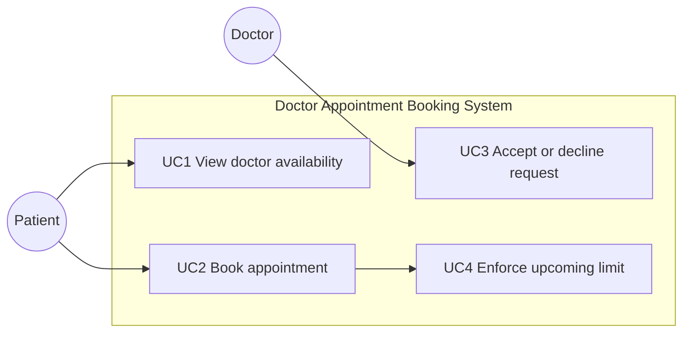

# Use Cases

Actors: **Patient** and **Doctor**.

The system is an educational in-memory booking program. Use cases describe intended workflow. They do not claim real medical-data security or production performance.

**N = 3 is confirmed by the instructor.**

## Use case diagram

## UC1 — View doctor availability

- **Use case ID:** UC1
- **Use case name:** View doctor availability
- **Primary actor:** Patient
- **Goal:** See the days and times when a chosen doctor is available (R1, R6).
- **Preconditions:** The patient and doctor exist. The doctor has offered one or more time slots.
- **Main success flow:**
  1. The patient selects a doctor.
  2. The system compares offered slots with the current clock and occupied PENDING/ACCEPTED bookings.
  3. The system returns the remaining future slots.
- **Alternative flow:** No slots remain. The system returns an empty list instead of inventing times.
- **Postconditions:** No appointment is created. Occupied and past slots are not shown as available.

## UC2 — Book an appointment

- **Use case ID:** UC2
- **Use case name:** Book appointment
- **Primary actor:** Patient
- **Goal:** Request an appointment during an available slot (R2, R4).
- **Preconditions:** The patient can view availability. The chosen slot is offered, in the future, and unoccupied. The patient has fewer than N upcoming appointments.
- **Main success flow:**
  1. The patient chooses an available slot.
  2. The system confirms the slot is still unoccupied.
  3. The system confirms the patient's upcoming count is below N (N = 3).
  4. The system creates a PENDING appointment and occupies the slot.
- **Alternative flow A — slot unavailable or already booked:** The system rejects the request. No appointment is created.
- **Alternative flow B — upcoming limit reached:** The system rejects the request with the N limit message. No appointment is created.
- **Postconditions (success):** A PENDING appointment exists and the slot is no longer available. **Postconditions (failure):** System state is unchanged.

## UC3 — Accept or decline an appointment request

- **Use case ID:** UC3
- **Use case name:** Accept or decline appointment request
- **Primary actor:** Doctor
- **Goal:** Decide a pending request (R3).
- **Preconditions:** A PENDING appointment exists for this doctor.
- **Main success flow — accept:**
  1. The doctor selects the pending request.
  2. The system sets status to ACCEPTED.
  3. The slot remains occupied.
- **Alternative flow — decline:** The doctor declines. Status becomes DECLINED. The slot is freed and no longer counts toward the patient's upcoming limit.
- **Alternative flow — not pending:** Accepting or declining a non-pending appointment is rejected.
- **Postconditions:** Status is ACCEPTED or DECLINED according to the decision. A declined slot may be booked by another patient.

## UC4 — Enforce the maximum number of upcoming appointments

- **Use case ID:** UC4
- **Use case name:** Enforce upcoming appointment limit
- **Primary actor:** Patient (invoked by the system during booking)
- **Goal:** Ensure a patient has at most N upcoming appointments (R4).
- **Preconditions:** A booking attempt is in progress.
- **Main success flow:** The patient's PENDING and ACCEPTED future appointments are fewer than N. Booking continues.
- **Alternative flow:** The count is already N. Booking is rejected.
- **Postconditions:** The patient never holds more than N upcoming appointments at the current clock.

## Mapping to non-functional requirements

- **R5:** Medical notes are not shown during UC1–UC4. Only a requester marked as authorized staff can retrieve them in this educational model.
- **R6:** UC1 is implemented as an in-memory lookup intended to complete quickly; tests check a 2-second bound on the sample data.
- **R7:** These use cases are demonstrated through a command-line program, not a mobile layout.
