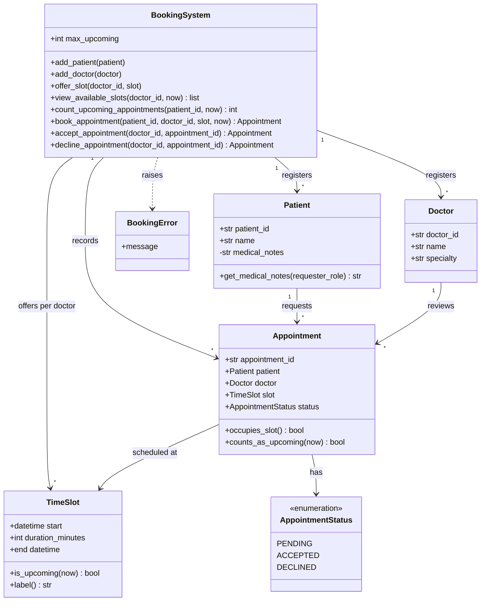

# Class Diagram

The diagram matches `3_candidate_classes.md` and `main.py`.

**N = 3** is stored as `BookingSystem.max_upcoming` (default `MAX_UPCOMING_APPOINTMENTS`).

Slot occupancy and the upcoming count use `Appointment.occupies_slot()` and `Appointment.counts_as_upcoming(now)`:

- PENDING and ACCEPTED occupy a slot.
- Only PENDING or ACCEPTED appointments whose slot start is after `now` count toward N.
- DECLINED frees the slot and does not count toward N.

