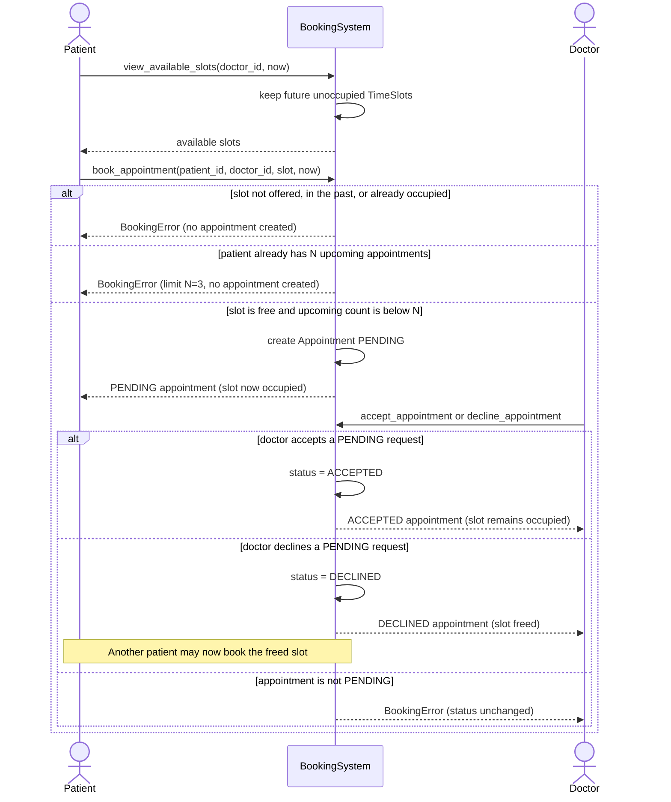

# Sequence Diagram

This diagram shows the appointment-booking process used by `BookingSystem` in `main.py`. It includes availability checking, the N upcoming-appointment limit, duplicate/unavailable slot handling, appointment creation, and the doctor's accept or decline decision.

Participants match the class diagram: Patient, BookingSystem, Doctor, TimeSlot, and Appointment.

A successful booking is shown only after validation succeeds. Failed validation does not create an appointment.

